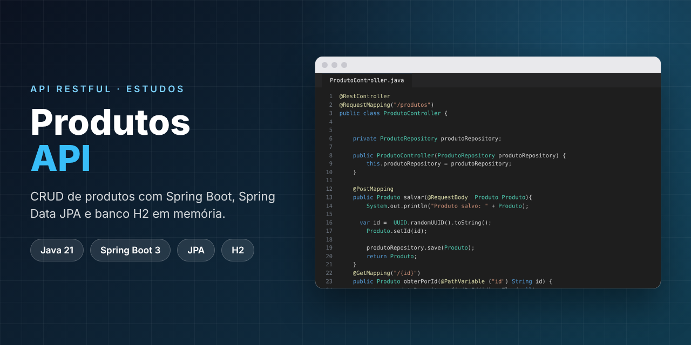
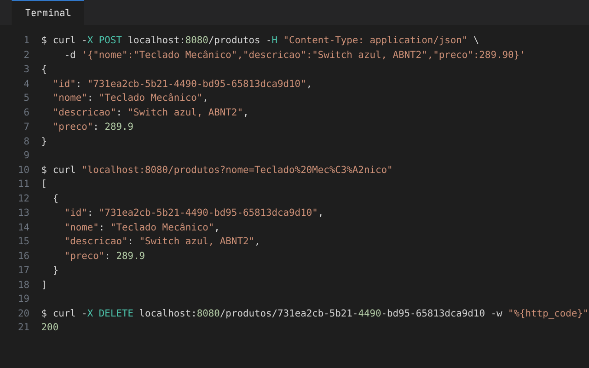

<p align="center">
  
</p>

<h1 align="center">📦 Produtos API</h1>

<p align="center">
  API <b>RESTful</b> para gestão de produtos, feita com <b>Spring Boot</b> e <b>Spring Data JPA</b> sobre um banco
  <b>H2</b> em memória. Projeto de estudo, base para praticar desenvolvimento web em Java.
</p>

<p align="center">
  
  
  
  
  
</p>

<p align="center">
  <a href="#-sobre-o-projeto">Sobre</a> •
  <a href="#-funcionalidades">Funcionalidades</a> •
  <a href="#-endpoints-da-api">Endpoints</a> •
  <a href="#-telas">Telas</a> •
  <a href="#-como-executar">Como executar</a> •
  <a href="#-testando-com-o-postman">Postman</a> •
  <a href="#-estrutura-do-projeto">Estrutura</a>
</p>

---

## 📌 Sobre o projeto

Aplicação de foco acadêmico com um CRUD completo de produtos. Cada produto tem `id` (UUID gerado pela API),
`nome`, `descricao` e `preco`. A tabela `produto` é criada pelo script [`data.sql`](src/main/resources/data.sql)
num banco **H2 em memória**, então não é preciso instalar banco de dados: os dados existem enquanto a aplicação está
rodando.

## ✨ Funcionalidades

| | Recurso | Descrição |
|---|---|---|
| ➕ | **Criar** | Cadastra um produto e gera o `id` automaticamente com `UUID` |
| 🔎 | **Buscar por ID** | Retorna os dados de um produto |
| ✏️ | **Atualizar** | Substitui os dados do produto com o `id` informado |
| 🗑️ | **Excluir** | Remove o produto pelo `id` |
| 🏷️ | **Pesquisar por nome** | Lista os produtos com o nome informado (busca pelo nome exato) |

## 📌 Endpoints da API

### 1. Criar produto
* **Método:** `POST`
* **Rota:** `/produtos`
* **Descrição:** cria um novo produto. O `id` é gerado automaticamente (UUID) e o produto salvo é devolvido no corpo.
* **Corpo da requisição (JSON):**
  ```json
  {
    "nome": "Mouse Gamer",
    "descricao": "Mouse com LED RGB e 3200 DPI",
    "preco": 150.00
  }
  ```

### 2. Buscar produto por ID
* **Método:** `GET`
* **Rota:** `/produtos/{id}`
* **Exemplo:** `/produtos/550e8400-e29b-41d4-a716-446655440000`

### 3. Atualizar produto
* **Método:** `PUT`
* **Rota:** `/produtos/{id}`
* **Corpo da requisição (JSON):**
  ```json
  {
    "nome": "Mouse Gamer",
    "descricao": "Mouse com LED RGB e 6400 DPI",
    "preco": 180.50
  }
  ```

### 4. Deletar produto
* **Método:** `DELETE`
* **Rota:** `/produtos/{id}`

### 5. Pesquisar produto por nome
* **Método:** `GET`
* **Rota:** `/produtos?nome={nome}`
* **Descrição:** usa o `findByNome` do Spring Data JPA, que compara o **nome completo**:
  `/produtos?nome=Mouse%20Gamer` encontra o "Mouse Gamer", mas `/produtos?nome=Mouse` não.

## 🖼️ Telas

<table>
  <tr>
    <td align="center"><b>Criar, pesquisar e excluir um produto com curl</b><br></td>
  </tr>
</table>

## 🚀 Como executar

**Pré-requisito:** JDK 21. O Maven Wrapper (`mvnw`) já vem no projeto.

```bash
git clone https://github.com/kauaxp77/Api_Rest.git
cd Api_Rest
./mvnw spring-boot:run
```

Ou gere o `.jar` e rode:

```bash
./mvnw -DskipTests package
java -jar target/produtosapi-0.0.1-SNAPSHOT.jar
```

A API fica disponível em `http://localhost:8080`.

### ✅ Testes

O projeto tem um teste de contexto (`ProdutosApiApplicationTests`), que verifica se a aplicação sobe:

```bash
./mvnw test
```

## 🧪 Testando com o Postman

Para testar a pesquisa de um produto pelo nome (ou qualquer outro endpoint) com o **Postman**:

1. Abra o **Postman** e crie uma nova requisição (botão **+**).
2. Na caixa de seleção de método, escolha **GET**.
3. Na barra de endereço, insira: `http://localhost:8080/produtos`
4. Vá até a aba **Params** (logo abaixo da barra de URL).
5. Na coluna **Key**, digite `nome`.
6. Na coluna **Value**, digite o nome do produto (exemplo: `Mouse Gamer`).
7. Clique no botão azul **Send**.
8. O resultado aparece na área inferior (aba **Body**), em JSON.

## 📁 Estrutura do projeto

```
Api_Rest/
├── src/main/java/io/github/cursodsousa/produtosapi/
│   ├── ProdutosApiApplication.java        # Classe principal
│   ├── controler/ProdutoController.java   # Endpoints /produtos
│   ├── model/Produto.java                 # Entidade JPA
│   └── repository/ProdutoRepository.java  # Spring Data JPA (findByNome)
├── src/main/resources/
│   ├── application.yml                    # Configuração do H2
│   └── data.sql                           # Criação da tabela produto
├── src/test/java/…/ProdutosApiApplicationTests.java
├── docs/
│   ├── banner.png
│   └── screenshots/
├── mvnw / mvnw.cmd                        # Maven Wrapper
└── pom.xml
```

## 🛠️ Tecnologias

* **Java 21**
* **Spring Boot 3.2.5**
* **Spring Web** (endpoints REST)
* **Spring Data JPA** (persistência)
* **H2 Database** (banco em memória)
* **Lombok** (declarado no `pom.xml`)
* **JUnit 5** e **Spring Boot Test**

## 👨‍💻 Autor

Desenvolvido por **[kauaxp77](https://github.com/kauaxp77)**

<p align="center">⭐ Se curtiu o projeto, deixe uma estrela!</p>
